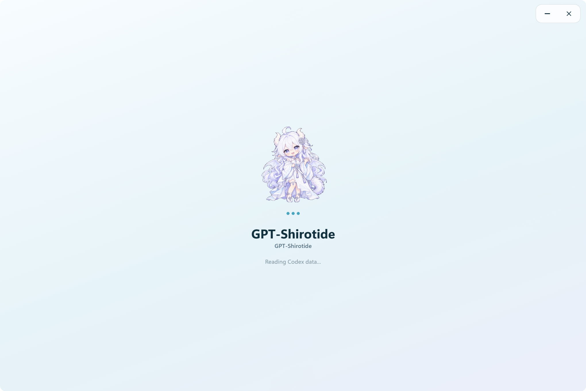

# GPT-Shirotide / GPT-白汐

[简体中文](README.md) · [Download 2.0.0-rc.2](https://github.com/Nahida728/gpt-quota-pet-Shirotide/releases/tag/v2.0.0-rc.2)

**GPT-Shirotide** is a Windows x64 Electron workspace and white-dragon desktop companion for Codex quotas, tasks, token usage and API-equivalent costs.

**Current version: 2.0.0-rc.2, a release candidate.** The repository is now `gpt-quota-pet-Shirotide`. The application ID and local data directory are retained. Upgrade from 1.x by downloading this release manually; stable updates do not install RC builds.

### Running app screenshots

Captured from the Windows x64 2.0.0-rc.2 build.

### Features

| Area | What it provides |
| --- | --- |
| Overview | Five-hour, weekly and independent GPT Reserve quotas; latest task, trends, model composition and reset forecasts |
| Usage and cost | Account totals, editable third-party ledgers, model details, day/week/month charts and searchable pricing |
| Task center | Compact multi-column cards, running/pending filters, sorting, goals, subagents and centered detail dialogs |
| Quotas and resets | Recovery times, credits, permanent grant/consumption history, announcements, calendars and subscription details |
| Client updates | Observed Codex version changes and pending update status |
| Settings | Pet, audio, pinning, tray behavior, custom backgrounds, glass appearance, sources, diagnostics and app updates |

### Your desktop companion

Enter pet mode with the paw button or Settings. Use its context menu or tray to return to the workspace. Squeezing opens or refreshes quotas; **clicking the bubble** switches to a GPT catchphrase, then closes it. Each bubble closes after seven seconds. Repeated pet clicks never open the workspace.

The pet supports spring squeezes, proportional native dragging, throws, screen-edge bounces and catching. Adjust size, pinning, bubbles and duck audio. Reduced motion is respected. Taskbar, tray and sidebar share mascot artwork; startup uses a local GIF with a static fallback.

### Third-party usage

Choose any provider and model names. Append models to a provider, increment a model, or replace its manual totals. Total-only entries estimate input/output and cache using shared presets; exact entries support input, cache-read, cache-write and output counters. Personal records are never bundled. Changes retain backups and reject stale model revisions.

### Installation

1. Open [Release v2.0.0-rc.2](https://github.com/Nahida728/gpt-quota-pet-Shirotide/releases/tag/v2.0.0-rc.2).
2. Install `gpt-shirotide-2.0.0-rc.2-setup-x64.exe`, or run `gpt-shirotide-2.0.0-rc.2-portable-x64.exe` directly.
3. Install the official Codex Windows client and sign in. No API Key entry is required here.
4. Use the fixed 1200 × 800 DIP workspace, reduced only for smaller work areas. Drag its title space; configure pinning and close-to-tray behavior in Settings.
5. Upload or drop a background, adjust framing, opacity and blur, then apply to save.

Compare downloads against `SHA256SUMS-v2.0.0-rc.2.txt` using `Get-FileHash -Algorithm SHA256`. Windows x64 and network access to OpenAI are required. API-key mode usually does not supply subscription quotas. An absent independent Reserve bucket stays unavailable.

### Reading the numbers

Account totals come from Codex's summary. Combined totals use the same base plus explicitly attributed third-party calls and manual entries. Without third-party usage, both totals match. Model composition allocates the base by observed weights; it is an estimate. Local details cover only readable local and archived records.

API-equivalent costs use the app's vendor text pricing and context rules; they are not subscription bills or reseller charges. Cached reads/writes are subsets of input. Missing rates retain Tokens and mark costs incomplete. Cache hit rate is cached input / input. Recorded-interval output rates differ from decoder throughput; whole-turn averages include tools and waiting. Missing latency, streaming duration or speed-tier evidence stays unavailable.

Reset data comes from [Codex Reset](https://codex-reset.com/) and [Codex Reset Tracker](https://codexresettracker.com/). Announcements do not confirm a reset for your account. Forecasts remain hidden when stale or insufficiently sampled.

### Privacy, updates and development

Data stays in `%APPDATA%\codex-quota-monitor`. Branding preserves this directory. Keep `quota-state.json.archive` for recovery. The app does not upload conversations or expose credentials to its renderer. Network requests serve local Codex integration, public reset checkpoints and GitHub updates.

RC uses the `rc` prerelease channel; stable builds accept stable releases only. Updates restart this app when observed tasks are idle, or on an explicit action. Codex tasks continue running. Portable updates verify digests and retain the previous executable for rollback.

Use `npm ci`, `npm start`, focused `node --test` checks and `npm run build -- --publish never`. Read [AGENTS.md](AGENTS.md) first. Only source and package metadata enter ASAR; personal data and development files stay excluded. See [asset notes](docs/pet-assets.md) and [changelog](CHANGELOG.md).
