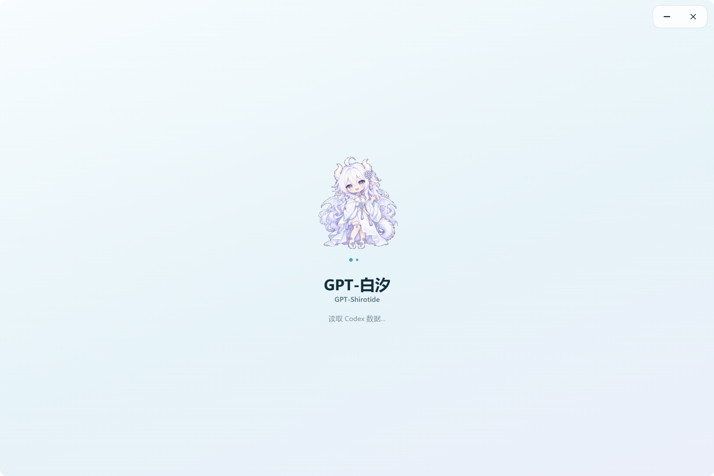

# GPT-白汐 / GPT-Shirotide

<p align="center"></p>
<p align="center">Codex 额度工作台与白龙桌宠 · A white-dragon companion for your Codex workspace</p>

[](https://github.com/Nahida728/gpt-quota-pet-Shirotide/releases)


[下载 2.0.0-rc.2](https://github.com/Nahida728/gpt-quota-pet-Shirotide/releases/tag/v2.0.0-rc.2) · [更新日志](CHANGELOG.md) · [问题反馈](https://github.com/Nahida728/gpt-quota-pet-Shirotide/issues) · [English](README.en.md)

GPT-白汐是一款 Windows x64 Electron 应用，汇总 Codex 额度、任务、Token 用量和 API 等价费用。收起工作台后，白龙小宠物留在桌面，可以捏捏、拖动、甩出，也能查看五小时和一周额度。

**当前版本：2.0.0-rc.2，候选发布版。** 原仓库 `codex-quota-monitor` 已更名为 `gpt-quota-pet-Shirotide`。应用标识和本地数据目录保持不变。从 1.x 升级请手动下载本版本；正式版更新通道不会自动安装 RC。

## 实机截图

以下画面来自 2.0.0-rc.2 Windows x64 实际运行版本。



<p align="center"></p>

## 功能

| 页面 | 内容 |
| --- | --- |
| 总览 | 五小时、一周与独立 GPT Reserve 额度，最近任务、趋势、模型构成及重置预测 |
| 用量与费用 | Codex 账号累计、第三方账本、模型明细、日/周/月趋势和可搜索价目表 |
| 任务中心 | 紧凑多列卡片、筛选排序、目标与子代理、居中详情弹窗和累计记录 |
| 额度与重置 | 恢复时间、重置券、领取/消耗历史、公开公告、年度日历及订阅信息 |
| 客户端更新 | Codex 已安装版本变更时间线与待更新状态 |
| 设置 | 桌宠、音效、置顶、托盘、背景构图、透明度、来源、诊断与软件更新 |

### 桌宠

点击爪印或在设置中进入宠物模式，通过右键菜单或托盘回到工作台。捏宠物只显示或刷新额度；**点击气泡**切换为 GPT 碎碎念，再点一次关闭。气泡也会在七秒后消失。反复点击宠物不会打开主窗口。

快速连捏保留弹簧速度，拖动时保持原始比例。松手甩出后可在屏幕工作区内反弹，再次按住即可接住。支持大小、置顶、气泡和小黄鸭音效设置，尊重系统减少动态效果。宠物、任务栏、托盘和主页使用同一形象；开屏采用本地 GIF 和静态回退。

### 第三方账本

供应商和模型名称可自定义。可以向已有供应商追加模型，也可以对已有模型选择**增量更新**或**直接修改**。只有总 Token 数时，可用预设输入占比和缓存命中率估算；有准确计数时可分别录入输入、缓存读取、缓存写入和输出。

账本保存在本机，不预置个人用量。手动修改保留安全备份，按模型核对版本，避免旧界面覆盖新数据。

## 下载与使用

1. 打开 [v2.0.0-rc.2 Release](https://github.com/Nahida728/gpt-quota-pet-Shirotide/releases/tag/v2.0.0-rc.2)。
2. 下载 `gpt-shirotide-2.0.0-rc.2-setup-x64.exe` 安装，或直接运行 `gpt-shirotide-2.0.0-rc.2-portable-x64.exe`。
3. 安装并登录官方 Codex Windows 客户端。额度通过本地 app-server 读取，无需在本软件输入 API Key。
4. 主窗口固定为 1200 × 800 DIP，小屏幕按工作区收缩。拖动标题空白处移动，在设置中选择置顶和关闭到托盘。
5. 点击或拖入背景图片，调整构图、强度、模糊和卡片透明度，点击应用保存。

发布页附 `SHA256SUMS-v2.0.0-rc.2.txt`。校验示例：

```powershell
Get-FileHash .\gpt-shirotide-2.0.0-rc.2-portable-x64.exe -Algorithm SHA256
```

需要 Windows x64 和可访问 OpenAI 的网络。API Key 模式通常不提供订阅额度。服务未返回独立 Reserve 桶时显示不可用，不从主额度推算。

## 统计口径

- **账号累计**来自 Codex 摘要；**综合累计**使用同一个 Codex 基数，加明确归属的本地第三方调用和手动账本。没有第三方记录时两侧相同。
- **模型构成**按已观测模型权重分摊 Codex 基数再合并第三方，属于估计。**本机明细**只覆盖可读取的普通/归档记录，不代表全部设备或账户活动。
- **API 等价费用**按应用内厂商标准文本定价及上下文规则估算，不是订阅账单或实扣。缓存读取/写入属于输入，不能重复相加；缺价保留 Tokens 并标记金额不完整。
- **缓存命中率**为缓存输入 / 总输入，按输入量加权。区间输出速率来自带时间戳的计数，整回合平均值包含工具与等待。首字延迟、流式时长和 Standard/Fast/UltraFast 挡位缺少明确记录时显示“—”。
- **重置公告和预测**来自 [Codex Reset](https://codex-reset.com/) 和 [Codex Reset Tracker](https://codexresettracker.com/)，不证明当前账户已被重置。来源过期或样本不足时不显示概率。

## 数据与更新

设置、背景、手动账本和历史保存在 `%APPDATA%\codex-quota-monitor`。品牌升级不迁移或清空该目录。请保留 `quota-state.json.archive` 用于历史恢复；开发预览使用独立目录。

本应用不上传对话，不向界面暴露凭据、API Key 或原始会话。额度由本地 Codex app-server 提供；网络还用于公开重置检查站和本仓库更新。

RC 使用 `rc` 预发布通道，正式版只接收正式版本。下载后在已观测任务空闲时重启本应用，也可手动操作。更新不会停止 Codex 或它的任务；便携版校验摘要并保留旧程序以便回退。

## 开发

```powershell
npm ci
npm start
# 运行与改动直接相关的测试
node --test test/renderer-layout.test.js test/localization.test.js
# 本地构建，不自动上传
npm run build -- --publish never
```

源码在 `src/`，修改前阅读 [AGENTS.md](AGENTS.md)。打包仅允许 `src/**/*` 和 `package.json`；开发说明、测试、脚本、日志及个人数据不进入应用。素材制作与第三方资源说明见 [pet-assets.md](docs/pet-assets.md)。
