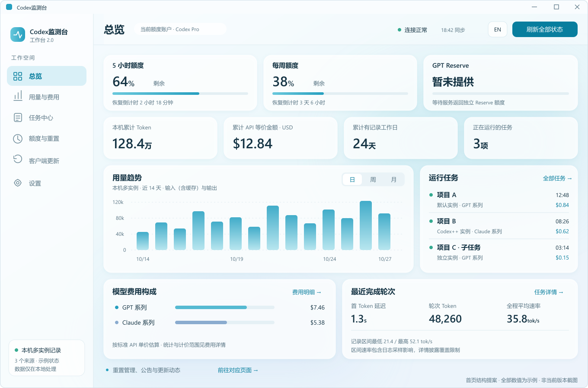

# Codex监测台 2.0 产品升级方案

日期：2026-10-28。状态：方案已批准，2.0.0-beta.1 实施中。

更新要求已纳入：压缩空白、采用无边框大窗口、统一 SVG；背景默认完整显示且不自动放大小图。下方原始线框仅作为信息分区参考。

## 1. 产品方向

将现有桌面悬浮卡片升级为可调整大小、可最大化的 Windows 桌面工作台。主色为白色与天青色，用户背景贯穿各页面，内容使用磨砂玻璃卡片。首页回答“还剩多少额度、用了多少、哪些任务正在运行”，详细分析进入对应页面。

本轮明确取消吸顶、顶部收起标签、悬浮球、固定小窗口和它们的设置入口。无边框大窗口保留最小化、最大化、还原、任务栏、托盘、后台监控和可选置顶。位置锁定随悬浮卡片模式一并退役。

实现时以用户本次要求替换 AGENTS.md 中固定 460 × 690、76 × 76 悬浮球、吸顶、四边拖动条和固定竖版背景等产品约束；继续保留数据、隐私、双语和打包约束。现阶段不提前修改这些现行工程规则。



该图表达首页分区和视觉方向，并非当前版本截图。可编辑版本：[SVG 布局图](product-upgrade-2.0-overview.svg)。

## 2. 竞品参考与取舍

调研基于公开产品页面、官方仓库说明；以下“采用方式”为本项目的设计建议。

| 参考对象 | 已核实的相关设计/功能 | 本项目采用方式 |
| --- | --- | --- |
| [codeusagemonit](https://github.com/fanchengliu/codeusagemonit) | 提供完整面板、用量图表、模型费用、第三方用量分组和可调背景 | 参考完整面板的信息分区，给费用和任务真正的页面空间 |
| [UsageDeck](https://github.com/lamchun1110/UsageDeck) | 集中显示额度、重置时间、重置次数到期、Token 历史、估算费用和多账户卡片 | 统一额度卡片的字段顺序，清楚呈现数据来源、有效期与状态 |
| [OpenUsage](https://www.openusage.ai/) | 按提供方组织额度，将会话/周限额、恢复时间和费用摘要放在同一入口 | 采用清楚的主次数字、简短状态文案和可展开详情 |
| [Fluent 2 材质体系](https://fluent2.microsoft.design/material) | 将实体、磨砂半透明、Mica 和遮罩区分为不同材质 | 为窗口底层、卡片、侧栏和模态遮罩设置不同透明度与层级 |

视觉采用本项目自己的白色与天青色规范。竞品的托盘弹窗、小窗尺寸切换、多平台认证、云同步和自定义远程接口不随此次布局改造自动加入。

## 3. 窗口与响应式规则

- 采用无边框大窗口和隐藏标题栏，保留 Windows 原生窗口按钮；工具栏空白区域支持原生拖动，边缘支持系统缩放，支持最大化、任务栏和系统分屏。
- 首次打开以 **1360 × 900 DIP** 为目标；如果当前显示器工作区放不下，缩小至工作区内并留出适当边距。
- 常规最小尺寸 **1000 × 680 DIP**；较小工作区下调最小边界，保证窗口和控制按钮可达。恢复窗口时校验多显示器、缩放比例和失联显示器的位置。
- 保存最后的普通窗口位置、大小、最大化状态；最小化或隐藏时不把异常边界写成恢复尺寸。
- 默认使用普通任务栏窗口；保留托盘显示/隐藏和显式退出。关闭按钮延续后台监控行为，并在“设置 → 常规”提供“关闭到托盘/退出”选项。
- 新用户置顶默认关闭；已有用户的置顶选择继续保留。移除位置锁定入口。
- 保留单实例锁和第二次启动唤回现有窗口的行为。

| 窗口宽度 | 布局行为 |
| --- | --- |
| ≥ 1200 DIP | 216px 文字侧栏；12 列内容网格；额度三列、摘要四列；图表与任务预览并排 |
| 1000–1199 DIP | 72px 图标侧栏，带提示和无障碍名称；额度保持三列；摘要两列；复杂内容改为单列 |
| 工作区迫使宽度 < 1000 DIP | 使用紧凑导航；额度和摘要按实际容器宽度降为两列或一列；页面正常纵向滚动 |

侧栏和顶部工具栏固定在各自区域，正文独立纵向滚动。大表格可在自身区域横向滚动，不把整个窗口撑宽。字号不随窗口缩小；图表根据容器重算绘图区、刻度与标签密度。

## 4. 导航与全部功能去向

采用六个一级页面。页签、筛选和详情有稳定的返回路径；页面切换保留筛选、排序、滚动位置，语言切换不清空这些状态。

| 页面 | 内容及交互 |
| --- | --- |
| **总览** | 5 小时/每周/Reserve 额度；本机累计 Token、API 等价金额、累计工作日、运行任务数；用量趋势；运行任务预览；模型费用构成；最新完成轮次性能；重置与更新动态入口 |
| **用量与费用** | “用量趋势 / 模型费用 / 计价说明”页签；日周月聚合、日期范围、输入/缓存/输出、缓存命中、工作日与日均指标；模型表格、价格来源和日期、长上下文与缓存写入规则、待计价状态 |
| **任务中心** | “运行中 / 待确认 / 统计”页签；项目、模型、状态、主任务/子任务等筛选与持久排序；运行计时、费用、完成/手动中断/异常中断；一键确认已完成；最长、最高费、平均、总时长和结果计数；右侧抽屉展示单任务详情与性能记录 |
| **额度与重置** | 当前认证账户的三类额度及特殊状态；套餐、到期与续订倒计时；“可用重置 / 领取记录 / 使用记录 / 官方公告 / 重置预测”页签，保留完整明细、来源、日历和预测限制 |
| **客户端更新** | 分开呈现 Codex 客户端版本、待安装状态、永久版本时间线，以及监测台自身的版本、检查与安装更新入口 |
| **设置** | “常规 / 外观与背景 / 实例与数据 / 连接诊断 / 关于”；语言、置顶、托盘行为、背景调整；已发现实例与索引状态、现有数据重扫；连接诊断和版本信息 |

顶部工具栏只放页面标题、可点击的连接状态、最近同步时间、语言切换和一个统一刷新按钮。日期和实例筛选属于具体统计页面，不能把某一实例的用量误套到当前账户的远程额度上。

### 首页结构示意

```text
┌────────────────────── Windows 标准标题栏 ──────────────────────┐
│ 固定侧栏 │ 页面标题     连接状态 / 同步时间 / 语言 / 统一刷新     │
│          ├─────────────────────────────────────────────────────┤
│ 总览     │ 5 小时额度       每周额度          GPT Reserve       │
│ 用量费用 │ 累计 Token   API 等价金额   累计工作日   运行任务      │
│ 任务中心 │                                                     │
│ 额度重置 │ 用量趋势图（8 列）       运行任务预览（4 列）         │
│ 客户更新 │                                                     │
│ 设置     │ 模型费用构成（6 列）     最近完成轮次（6 列）         │
│          │ 重置领取、官方公告、更新动态 → 对应详情页            │
└──────────┴─────────────────────────────────────────────────────┘
```

首页运行任务预览显示最多四项，包含项目、模型、时长和金额；更多任务进入任务中心。额度卡片同时显示剩余比例、恢复时刻和倒计时。Reserve 未返回时明确显示不可用；5 小时额度暂停时使用官方特殊状态文案。

首页只放摘要；详情页承担长文案、覆盖范围帮助、历史和完整表格。不得通过删掉字段或缩小字体让内容硬塞进首屏。

## 5. 白色与天青色视觉规范

| 元素 | 建议规范 |
| --- | --- |
| 默认底色 | 冰白 `#F3F8FC`，叠加很轻的天青色渐变 |
| 主色 | 天青 `#5BB8D2`，用于选中状态、图表与装饰 |
| 强操作/链接 | 深天青 `#087E9E`，按钮文字与背景保持可读对比 |
| 主文字/次文字 | `#163545` / `#526E7E` |
| 玻璃卡片 | 白色约 76% 不透明度，18–24px 模糊，1px 浅边框，轻阴影 |
| 圆角与间距 | 卡片 18px、控件 10px；页面内边距 24px；卡片间距 16px |
| 字体 | 正文 14–15px、页标题 24px、主指标 28–36px；数字使用等宽数字排布 |
| 状态色 | 绿色表示正常，橙色表示需注意，红色表示异常；始终同时显示文字或图标 |

采用不透明原生窗口承载应用内背景，在背景上做 CSS 玻璃卡片，避免继续依赖整窗透明与原生裁切。Fluent 的 Mica 是不透明材质，不能代替用户图片上的磨砂卡片；这里采用应用内的玻璃层实现图片连续性。

只在主要容器使用模糊，不给每个表格单元重复加滤镜；提供“减少透明效果”，必要时自动回退为更实的白色表面。动画限于页面/抽屉淡入和指标过渡，支持减少动态效果，隐藏页面不维持图表动画循环。

## 6. 自定义背景重做

1. 支持点击与拖放 PNG、JPEG、WebP、GIF，保留 20MB 限制；解码前校验文件类型、像素规模和内存边界。GIF 默认采用静态帧，避免持续动画占用资源。
2. 上传后默认保留完整图片并按像素密度限制放大，另可选“铺满”和“原始像素大小”；提供位置、缩放、背景强度、背景模糊、白色遮罩和卡片不透明度。小图放大必须显式启用“允许放大小图”。调整即时预览，“应用”提交，“取消”恢复。
3. 提供可选的手动构图，比例为当前窗口、16:9、16:10；保存归一化构图和焦点，调整窗口大小时自动适配，无需重新裁切。
4. 去掉源图片必须大于 460 × 690 的校验、强制 460:690 裁切和固定 460 × 690 导出。新上传图片保留受限的源图和构图参数，显示资源按窗口尺寸与设备像素比生成，避免每次缩放重复处理原图。
5. 所有页面、侧栏和详情抽屉共享同一背景层；调节图片强度不会降低文字与按钮本身的不透明度。浅色、深色和高细节图片都必须可读。
6. 旧版已保存的背景继续作为兼容图片使用；原图不存在时不声称能恢复原始构图，也不要求用户重新上传才能使用。替换图片成功后再切换引用，取消或失败不能损坏原背景。

## 7. 交互与详情层级

- 旧 Token 趋势和模型费用弹窗迁入“用量与费用”，旧任务弹窗迁入“任务中心”，旧重置系列弹窗迁入“额度与重置”，旧更新历史迁入“客户端更新”。
- 套餐详情放在额度页面的订阅面板，首页的套餐入口可以直达该面板。
- 任务和模型的单项详情使用可关闭的右侧抽屉；窄窗口下占据正文区域，不能挤坏表格或覆盖系统窗口按钮。
- 只有背景构图、连接诊断、异常任务提醒、操作确认与覆盖范围说明保留模态对话框。统一焦点进入/归还、Escape 关闭和遮罩行为，不叠加多层弹窗。
- 正常/离线连接灯仍可点击；每次进程会话首次离线只自动提醒一次，诊断保留客户端、登录、API-key 模式、代理、VPN、防火墙、网络、服务和超时检查。
- 离线时页面继续展示上次安全快照、历史与来源时间，标识过期状态；不改写成本地在线，不清空任务数值记录。
- 收到新快照时按稳定 ID 更新行，不重建整个页面，不打断筛选、滚动、抽屉、键盘焦点或正在查看的任务。

## 8. 数据与统计展示约束

- 本机累计 Token 保持当前多实例口径：输入（已含缓存）加输出。官方账户总量单独呈现，不能相加，也不能互相封顶。
- 日均 Token 与日均 API 等价金额继续使用同一批有记录工作日；缺少日期的用量保留在总量中，日均按既有覆盖规则展示。
- 延续 Codex++ 等多开实例发现、归档去重、第三方接入记录解析、任务生命周期判断和现有各家模型计价。界面改版不触发全量计数重建或改变账本代次。
- “实例与数据”区分目录被发现、索引完成、部分可读和远程额度连接成功；只有远程请求成功返回额度才能显示账户在线。
- 实例筛选只使用日志/索引已有的可靠归属。旧记录无法归属时显示“来源未记录”，保留在总量里；筛选排除情况必须可见，不能按模型名猜实例、供应商账户或中转站。
- 金额统一标注“API 等价金额（USD）”。模型价格详情保留输入、缓存读取、短/长 TTL 缓存写入、输出、上下文档位、官方来源与核价日期；未知价格保留待计价，不显示为零。
- 统计覆盖标记只放在用量与任务等分析详情，保持双语解释：包含人群、排除项、分母、局部扫描与缺失时长。首页不增加一圈帮助按钮。
- 最新完成轮次保留真实首 Token 延迟、总 Token 和记录区间速率；缺少时间戳或扫描不完整时按原规则降级，不补造性能值。
- 永久重置记录、官方公告、客户端版本时间线、任务数值记录和不可变档案继续保留。重置预测仍需披露样本、来源时效和实验性；官方公告不改写成账户已重置。

本轮不把 Claude 模型计价扩展解释成 Claude 独立账户额度接入，也不因竞品支持更多平台而自动加入新的认证入口。

## 9. 工程改造边界

### 主进程与桥接

- `src/main.js`：替换固定透明无框窗口配置；删除吸顶/悬浮球状态机、原生裁切、模式切换绘制确认、固定尺寸拦截；接入普通窗口边界持久化、最大化恢复和多屏校验。
- `src/preload.js`：移除吸顶、悬浮球、锁定位置和专用拖动桥接；保留业务读取、订阅、刷新、背景、托盘与更新的窄接口。使用原生窗口按钮叠加层，无需增加自绘窗口控制权限。
- 专用 `native-window-drag` 模块如失去全部调用则删除；`koffi` 是否移除需先核查其他原生功能的依赖，不能连带破坏“返回 Codex”窗口聚焦。
- `src/store.js`：新增有版本的窗口/外观设置迁移，只写设置，采用现有安全写入方式；不更换 appId、用户数据目录或存档目录。

### 渲染层

- 从当前单文件的大量 DOM 操作中分出应用外壳、共享快照状态、页面渲染和共用组件。沿用原生 JavaScript，使用与 Electron CSP 兼容的本地模块组织，无需为此引入完整前端框架。
- 页面：总览、用量费用、任务、额度重置、更新、设置。组件：额度卡片、摘要、图表、表格、状态、抽屉、模态框、覆盖说明。
- CSS 使用统一设计变量、应用外壳、组件、页面和响应式规则；替换固定宽高与历史覆盖式样式，移除旧拖动边条、orb 和 top-dock 选择器。
- `crop-geometry.js` 复用已有几何基础，去掉调用方硬编码比例，补充归一化焦点和窗口变换处理。
- 用 ResizeObserver 观察实际内容容器。实时计时只更新必要节点；图表隐藏时暂停动画；页面切换正确释放监听。

### 安全和打包

保留 `contextIsolation: true`、`nodeIntegration: false`、`sandbox: true`、严格 CSP 和本地资源加载边界。认证材料、原始协议响应、对话正文不能进入渲染进程。打包继续保持 `src/**/*` 与 `package.json` 显式白名单，方案文档、原型、测试与截图不进入 ASAR。

## 10. 设置迁移

1. 首次启动新外壳前对旧设置做版本化迁移；失败时保留旧设置和历史，使用可恢复的普通窗口默认值。
2. 旧悬浮/吸顶/收起状态不再参与窗口恢复；旧 460 × 690 不作为新窗口尺寸。新窗口以正常可见状态启动，位置落到有效工作区。
3. 语言、用户明确选择的置顶状态、背景、背景强度与更新偏好继续保留。首次初始化使用新尺寸，之后按用户保存的正常窗口边界恢复。
4. `quota-state.json`、模型账本、不可变档案及其代次不因外观升级而修改结构或清空。

## 11. 实施顺序与每阶段交付

| 阶段 | 工作 | 可评审交付 |
| --- | --- | --- |
| 1. 新合同与外壳 | 更新 AGENTS 产品约束；普通窗口、侧栏、工具栏、设计变量、设置迁移 | 可缩放、可最大化、能恢复位置的工作台外壳；旧窗口模式入口移除 |
| 2. 首页 | 接入真实额度、累计统计、任务预览、趋势和最新轮次 | 首个完整页面；白色/天青色玻璃视觉和真实数据同时可检查 |
| 3. 业务页面 | 迁移用量费用、任务、额度重置、更新及全部详情入口 | 六页导航可用；原有功能有明确新入口；完成确认和异常提醒链路贯通 |
| 4. 外观与适配 | 背景上传/构图、图片迁移、响应式、双语、键盘与减少动态 | 自定义背景跨页面连续；窄窗口与英文可正常使用 |
| 5. 验收与本地构建 | 定向检查、真实数据核对、原生交互验证、打包与完整性检查 | 建议版本 2.0.0-beta.1 的本地便携版与安装版、哈希及已验证/未验证说明 |

每个阶段先完成可运行结果再继续，避免只完成新首页、其余页面仍依赖旧窗口的混合状态。外部发布、推送和安装不是本方案阶段的动作。

## 12. 验收标准

- **窗口**：正常缩放、最大化/还原、最小化、系统分屏、多屏移回、托盘恢复、第二实例唤回；不再出现吸顶、小窗、悬浮球和裁切残留。拖动过程中没有 JS 逐帧位置写入。
- **布局**：检查 1000 × 680、1360 × 900、1920 × 1080 DIP 及工作区更小的回退；125%/150%/200% Windows 缩放。页面正文可滚动，重要文案不省略，长英文/项目名不撑破容器。
- **背景**：无背景、浅图、深图、高细节图、旧竖图、新横图、取消构图和无效图片；放大、缩小与最大化不要求重传图片，文字始终可读。
- **全功能状态**：在线/离线、5 小时暂停、Reserve 缺失；重置列表 0/1/6/更多项；多开运行任务、完成待确认、手动/异常中断、子任务和目标步骤；新更新可安装、版本变化；双语的每页和剩余模态框。
- **数据**：同一安全快照在升级前后的 Token、费用、工作日、任务累计和永久历史一致；用真实账本做一次冷启动与档案恢复核对。无需为纯外观升级执行大规模重扫。
- **检查范围**：优先窗口设置迁移、背景几何、导航/IPC、双语、布局和打包的少量定向检查。只有发现统计或存档差异，才扩展相应业务验证；不默认重复全套回归。
- **交付门禁**：如执行构建，核对版本、x64、ASAR 白名单与源文件字节、产物 SHA-256；烟测新构建的实际进程，明确签名状态。原生交互与视觉不能仅凭静态源码判定完成。

## 当前交付范围

用户已批准实施。当前实现包含六页工作台、紧凑白色天青色布局、无边框窗口、原生窗口按钮、SVG 图标及背景完整显示/显式放大控制；运行与产物验证记录以对应版本验收文档为准。
